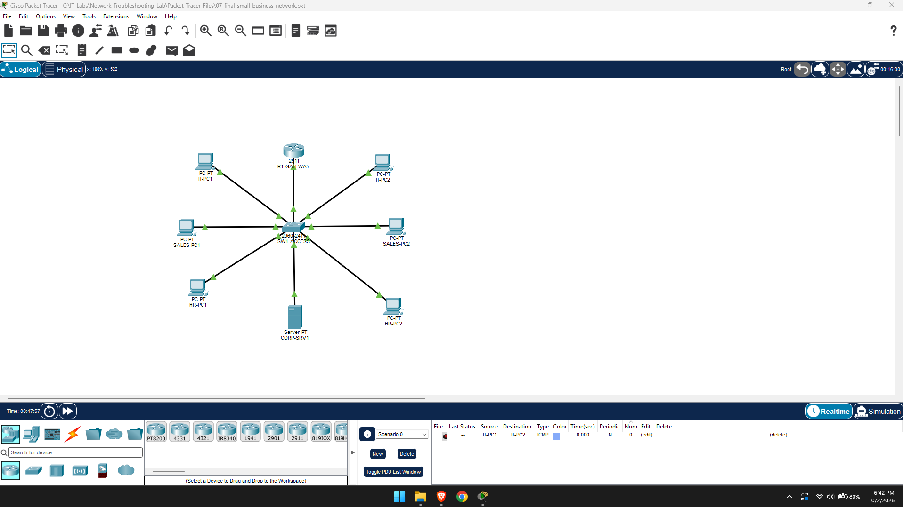
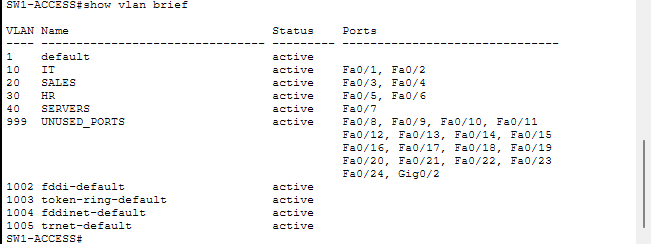
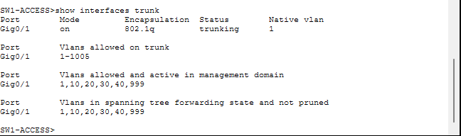
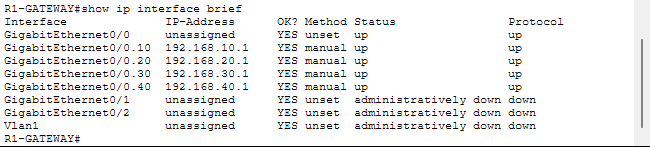
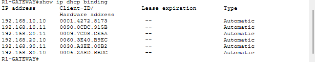
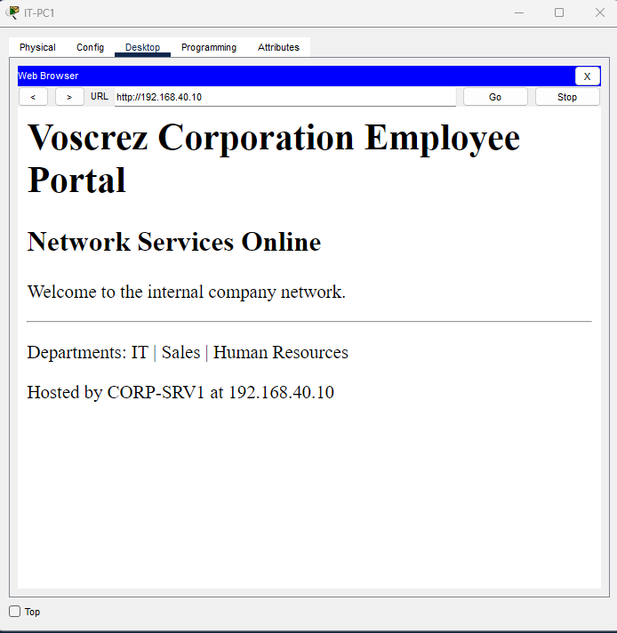
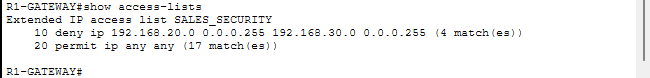
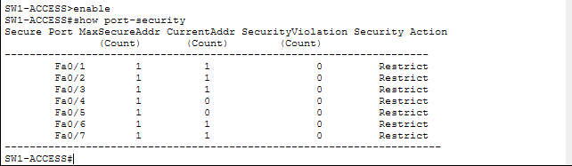

# Small-Business Network Troubleshooting Lab



## Project Overview

This project simulates a small-business network for the IT, Sales, and Human Resources departments. I designed and configured the network in Cisco Packet Tracer, separated departments with VLANs, enabled communication through router-on-a-stick, automated addressing with DHCP, deployed internal DNS and HTTP services, applied security controls, and resolved three realistic network support tickets.

The purpose of the project was to practice both network administration and evidence-based troubleshooting. Instead of only building a working network, I deliberately created faults, collected symptoms, identified each root cause, repaired the issue, and verified service restoration.

## Objectives

- Build a structured network for multiple business departments
- Separate departments using VLANs and distinct IPv4 subnets
- Configure an 802.1Q trunk and inter-VLAN routing
- Distribute network settings automatically with DHCP
- Provide internal DNS and HTTP services
- Secure unused and active switch ports
- Control department access with an extended ACL
- Diagnose and document realistic network failures

## Technologies and Concepts

- Cisco Packet Tracer 9.0
- Cisco IOS command-line interface
- IPv4 addressing and `/24` subnetting
- Cisco 2960 access switching
- VLANs and access ports
- IEEE 802.1Q trunking
- Router-on-a-stick
- DHCP pools and exclusions
- DNS A records
- HTTP server hosting
- Extended access control lists
- Switch port security with sticky MAC learning
- ARP, ICMP, MAC address tables, and traceroute

## Network Design

| Department or service | VLAN | Network | Default gateway | Connected ports |
|---|---:|---|---|---|
| IT | 10 | `192.168.10.0/24` | `192.168.10.1` | Fa0/1-Fa0/2 |
| Sales | 20 | `192.168.20.0/24` | `192.168.20.1` | Fa0/3-Fa0/4 |
| Human Resources | 30 | `192.168.30.0/24` | `192.168.30.1` | Fa0/5-Fa0/6 |
| Servers | 40 | `192.168.40.0/24` | `192.168.40.1` | Fa0/7 |
| Unused ports | 999 | Not routed | None | Fa0/8-Fa0/24, Gi0/2 |

### Infrastructure

| Device | Role | Important configuration |
|---|---|---|
| `R1-GATEWAY` | Inter-VLAN router and DHCP server | G0/0.10, G0/0.20, G0/0.30, and G0/0.40 |
| `SW1-ACCESS` | Department access switch | Gi0/1 trunk to router |
| `CORP-SRV1` | DNS and HTTP server | Static address `192.168.40.10` |

### Endpoints

- `IT-PC1` and `IT-PC2`: DHCP addresses from `192.168.10.0/24`
- `SALES-PC1` and `SALES-PC2`: DHCP addresses from `192.168.20.0/24`
- `HR-PC1` and `HR-PC2`: DHCP addresses from `192.168.30.0/24`

The router reserves `.1` through `.9` in each employee subnet for infrastructure. DHCP leases begin at `.10`. All employee DHCP pools distribute `192.168.40.10` as the DNS server.

## Major Configurations

### VLAN Segmentation

VLANs 10, 20, 30, and 40 separate IT, Sales, HR, and server traffic at Layer 2. Each endpoint port operates as an access port in its assigned VLAN. This reduces unnecessary broadcasts and creates clear security boundaries.



### Trunking and Inter-VLAN Routing

`SW1-ACCESS` Gi0/1 is an 802.1Q trunk connected to `R1-GATEWAY` G0/0. The router uses one subinterface per VLAN:

```text
G0/0.10  192.168.10.1/24
G0/0.20  192.168.20.1/24
G0/0.30  192.168.30.1/24
G0/0.40  192.168.40.1/24
```





### DHCP

`R1-GATEWAY` provides separate DHCP pools for IT, Sales, and HR. Each pool supplies the correct subnet mask, default gateway, and internal DNS address. DHCP bindings were verified from the router CLI.



### Internal DNS and HTTP

`CORP-SRV1` hosts the internal DNS record:

```text
intranet.corp.voscrez.test -> 192.168.40.10
```

The same server hosts the Voscrez Corporation employee intranet over HTTP. Clients can reach the page by its DNS name instead of memorizing the server address.



## Security Controls

### Extended ACL

An extended ACL named `SALES_SECURITY` blocks Sales VLAN traffic from directly accessing the HR subnet while permitting other required traffic. IT retains access to HR for technical support, and Sales can continue using DNS and the internal server.



### Switch Hardening

- Ports Fa0/8-Fa0/24 and Gi0/2 were placed in VLAN 999 and administratively disabled.
- Active endpoint ports use port security.
- Each protected port permits one sticky-learned MAC address.
- Violation mode is set to `restrict` so unauthorized traffic is dropped and counted.



## Troubleshooting Method

For each issue, I followed a repeatable process:

1. Identify and reproduce the symptom.
2. Gather evidence instead of guessing.
3. Check connectivity from the physical layer upward.
4. Compare the actual configuration with the intended design.
5. Correct the root cause.
6. Retest the affected service.
7. Document the issue, resolution, and verification.

## Completed Troubleshooting Tickets

| Ticket | Symptom | Root cause | Resolution |
|---|---|---|---|
| NT-001 | HR-PC2 could not reach its gateway or server | Fa0/6 was assigned to Sales VLAN 20 | Reassigned Fa0/6 to HR VLAN 30 |
| NT-002 | Intranet worked by IP but not by hostname | DNS service was stopped | Restarted DNS and verified the A record |
| NT-003 | IT-PC2 lost all connectivity | Fa0/2 was administratively shut down | Issued `no shutdown` and verified link recovery |

Full ticket records and evidence are available in [Troubleshooting-Tickets/Troubleshooting-Tickets.md](Troubleshooting-Tickets/Troubleshooting-Tickets.md).

## Validation Results

- Same-VLAN connectivity succeeded.
- Inter-VLAN routing succeeded through the default gateways.
- DHCP provided valid addresses, masks, gateways, and DNS settings.
- DNS resolved `intranet.corp.voscrez.test` to `192.168.40.10`.
- The internal HTTP page loaded by hostname.
- Sales-to-HR traffic was blocked by policy.
- IT-to-HR support traffic remained permitted.
- Unused ports remained disabled and isolated.
- Port security learned and protected connected endpoints.
- Every simulated fault was repaired and retested successfully.

## Repository Structure

```text
Network-Troubleshooting-Lab/
|-- README.md
|-- Packet-Tracer-Files/
|   |-- 01-basic-lan.pkt
|   |-- 02-wrong-network-troubleshooting.pkt
|   |-- 03-company-topology.pkt
|   |-- 04-server-services.pkt
|   |-- 05-secured-company-network.pkt
|   |-- 06-troubleshooting-tickets.pkt
|   `-- 07-final-small-business-network.pkt
|-- Device-Configs/
|-- Documentation/
|-- Screenshots/
`-- Troubleshooting-Tickets/
    `-- Troubleshooting-Tickets.md
```

## Skills Demonstrated

- Network design and documentation
- Cisco switch and router configuration
- Layer 2 and Layer 3 troubleshooting
- VLAN and subnet planning
- DHCP and DNS administration
- Service verification with `ping`, `ipconfig`, `tracert`, and Cisco show commands
- Network access control and switch hardening
- Root-cause analysis and help-desk ticket documentation
- Configuration checkpointing and recovery

## Author

**John Benjamin Jr.**  
Cybersecurity and IT Support student  
GitHub: [voscrez-cyber](https://github.com/voscrez-cyber)
